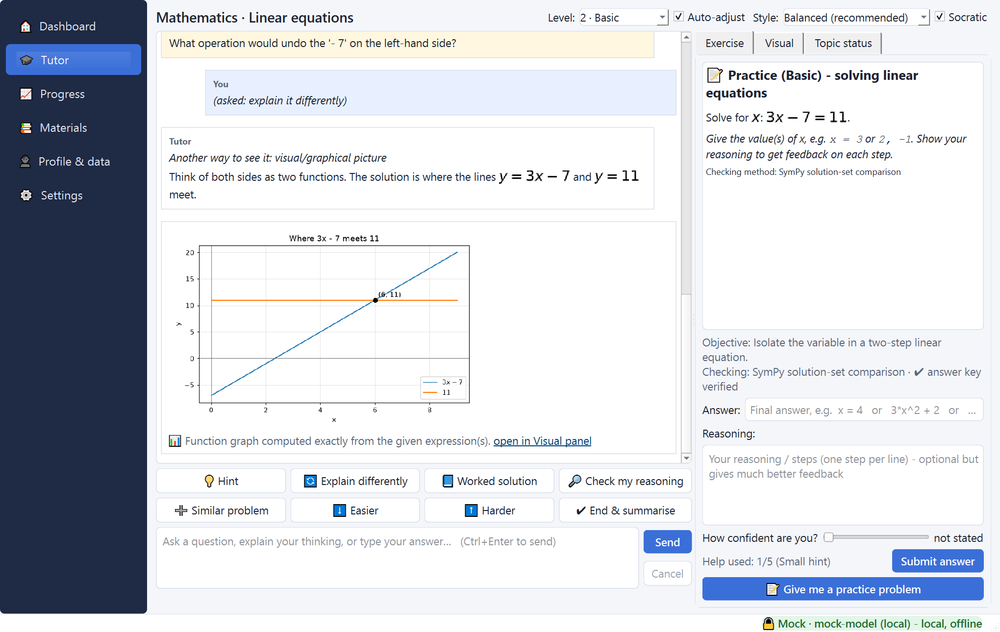

# Personal AI Tutor

A local Windows desktop tutor for high-school and university students. It works on maths, programming, statistics, economics and physics. The aim is to teach students how to solve problems, not to hand out answers. It explains concepts, asks one question at a time, gives hints in five escalating steps and diagnoses mistakes. It also generates and checks practice problems and records evidence of what the student has learned.

* **Local by default.** It runs on a local model through [Ollama](https://ollama.com). With no cloud configured, nothing leaves the computer.
* **Answers are checked by software where possible.** Results are compared with SymPy (symbolic and numeric checks, solution sets, a step-by-step equation checker), with unit-aware comparison, and by running code in a sandbox against test cases. The model's opinion is never treated as infallible. When the software check disagrees with the model, the check is used and the disagreement is shown.
* **Progress is based on evidence.** A concept counts as understood only after repeated, independent and varied success. One easy correct answer never marks it as mastered.



---

## 1. Architecture

```
tutor/
├── app.py               AppContext – wires all services (no UI code)
├── app_paths.py         %LOCALAPPDATA%\PersonalAITutor\{profiles,sessions,learning_history,materials,exports,cache,logs,backups}
├── config.py            Pydantic-validated TOML config (no secrets)
├── credentials.py       API keys via Windows Credential Manager (keyring) / env var fallback
├── logging_setup.py     rotating logs with secret redaction; no conversation content is logged
├── domain.py            Pydantic models: Session, Message, Exercise, Attempt, Evaluation, Evidence, ConceptStatus, …
├── llm/                 PROVIDER LAYER – the tutoring engine never imports a concrete provider
│   ├── base.py          LLMProvider interface, CancelToken, typed errors, capabilities/status
│   ├── ollama.py        local models: streaming, JSON-schema structured output, capability check, warm-up, keep-alive
│   ├── openai_compat.py cloud (OpenAI-compatible): SSE streaming, response_format, 401/404/429 handling, daily request budget
│   ├── router.py        local / cloud / hybrid routing + explicit, announced fallback (never silently to the cloud)
│   ├── structured.py    JSON extraction + Pydantic validation + ONE bounded repair round
│   └── mock.py          scripted provider for tests and demos
├── engine/              TUTORING ENGINE (pedagogy)
│   ├── tutor.py         TutorEngine: opening, conversation, exercises, answers, hints, solutions, explain-differently,
│   │                    check-reasoning, visuals, adaptive level, summaries, context compression
│   ├── prompts.py       system prompt (levels, styles, Socratic rules, subject guidance, prompt-injection guard)
│   ├── exercises.py     exercise generation + deterministic self-validation (+ SymPy correction of wrong answer keys)
│   ├── evaluator.py     deterministic check → LLM diagnosis → reconciliation → structured feedback
│   ├── hints.py         5-level assistance ladder, answer-leak detection, partial solutions
│   ├── knowledge.py     evidence-based mastery model (Not assessed / Introduced / Developing / Demonstrated / Needs revision)
│   └── difficulty.py    adaptive level policy (never reacts to a single answer)
├── tools/               DETERMINISTIC TOOLS
│   ├── safe_parse.py    whitelisted tokenizer before SymPy (SymPy's parser uses eval – raw input never reaches it)
│   ├── math_verify.py   equivalence, numbers, solution sets, step-chain checker (earliest wrong step)
│   ├── units.py         physical quantities & dimensional analysis (sympy.physics.units)
│   ├── code_runner.py   sandbox: AST whitelist + isolated interpreter + audit hook + timeout + Job Object memory limit
│   └── viz.py           14 Matplotlib visualisation kinds, values computed from a validated spec
├── materials/library.py PDF/TXT/MD ingestion (PyMuPDF, optional OCR), page-aware chunks, SQLite FTS5 retrieval
├── storage/             SQLite (WAL, transactional) + backup/restore + Markdown export
└── ui/                  PySide6 desktop app (dashboard, tutor workspace, progress, materials, profile & data, settings)
```

**Data flow for one answer:**

1. The student submits an answer in the UI.
2. `TutorEngine.submit_answer` runs `deterministic_check` (SymPy, units or the sandbox) and `check_steps` on the reasoning to find the first wrong step.
3. The LLM produces a structured `EvaluationDraft`, validated with Pydantic.
4. `reconcile()` combines the two. The software check decides whether the final answer is right; the LLM diagnoses the reasoning.
5. The engine composes respectful feedback with these parts: what's right, where it first goes wrong, why, which rule applies, and something to try.
6. It records an `Evidence` row, updates the knowledge model and applies the adaptive level policy.
7. Everything is persisted immediately, so an interrupted session can be resumed.

**Why custom orchestration rather than LangGraph?** The tutoring workflow is a small, explicit state machine: session → exercise → attempt → hint level. Plain Python is easier to test with mocked models and keeps the dependency list small.

**Security assumptions**

* The student is trusted but may paste untrusted content.
* LLM output, uploaded documents and code are untrusted. They are wrapped in `<material>`, `<student_answer>` and similar tags and declared as data in the system prompt.
* Generated or student code only runs in the sandbox. Math input passes the whitelist tokenizer before it reaches SymPy.
* No arbitrary shell access, no file access outside the app's data folder, and no network access from executed code.
* Deleting or restoring data always asks for confirmation.

---

## 2. Dependencies

Python 3.12 or 3.13 on Windows 10/11 (tested with 3.13.5). The packages are listed in `requirements.txt`:

| Package | Purpose |
|---|---|
| PySide6 | desktop UI |
| pydantic | data models and validation of LLM output |
| httpx | Ollama and OpenAI-compatible clients (streaming, timeouts, cancellation) |
| sympy, numpy, matplotlib | verification, units, plots, LaTeX rendering (mathtext, offline) |
| markdown, pygments | message rendering and code highlighting |
| keyring | API keys in Windows Credential Manager |
| pymupdf | PDF text extraction |
| tomli-w | writing the config |
| pytest, pytest-qt | tests |

pandas and SciPy were left out on purpose because NumPy and the standard library cover the statistics needed. Docker, servers and paid services are not required.

## 3. Installation (Windows)

1. Install **Python 3.12+** from python.org and tick "Add python.exe to PATH".
2. Install **Ollama** and a model (see §4).
3. Double-click **`run_tutor.bat`**. On first run it creates `.venv` and installs the dependencies. After that it starts the app.

   To do the same manually:

   ```bat
   py -3 -m venv .venv
   .venv\Scripts\python -m pip install -r requirements.txt
   .venv\Scripts\python -m tutor
   ```

Data is stored in `%LOCALAPPDATA%\PersonalAITutor\`. Set `TUTOR_DATA_DIR` to use another folder, for example a portable install on a USB stick. Paths with spaces and non-ASCII characters are supported and tested.

**Optional executable:** `pip install pyinstaller` and then `pyinstaller --name PersonalAITutor --windowed -p . tutor\__main__.py`. Keep model files out of the installer; Ollama manages them separately. Code exercises need a Python interpreter, see §12.

## 4. Configuring Ollama and a local model

1. Install Ollama for Windows from <https://ollama.com/download>. It runs in the system tray.
2. In a terminal, pull a model:
   * `ollama pull llama3.1:8b`: about 4.9 GB on disk and about 6.3 GB in RAM. This is the default. It needs roughly 8 GB of **free** RAM.
   * `ollama pull llama3.2:3b` or `qwen2.5:3b`: about 2 GB. Use one of these on laptops with 8 GB total RAM, or when browsers take up most of the memory.
   * `qwen2.5:7b` gives better structured output and maths at a similar size to llama3.1:8b.
3. In the app, open **Settings → Local model**, click **Refresh installed models**, pick the model, **Save**, and click **Test connection**. The test reports whether the model is installed, its context window, whether it supports tool calling, and the structured-output method.

No GPU is required. On CPU-only machines:

* Keep the **context window** fixed. Every change makes Ollama reload the model. The app always sends the same `num_ctx` and keeps the model loaded with `keep_alive = "30m"`.
* At startup the dashboard **preloads the model in the background**, so the first question doesn't wait for it to load.
* Choose **Speed vs quality → Fast** for shorter prompts and answers.

## 5. Configuring a cloud LLM API

1. Go to **Settings → Cloud model**, tick **Enable cloud provider**, and set the base URL and model ID. Examples:
   * OpenAI: `https://api.openai.com/v1`, `gpt-4o-mini`
   * OpenRouter: `https://openrouter.ai/api/v1`
   * A local LM Studio or vLLM server: `http://localhost:1234/v1`. This is treated as local.
2. Paste the API key. It is stored in **Windows Credential Manager** and never written to the config, logs or exports. You can also set the environment variable `TUTOR_CLOUD_API_KEY`.
3. Choose **Hybrid** or **Cloud** mode and **Save**. A notice explains that conversation content will leave the computer, and you must confirm it.
4. Optional settings:
   * Max requests per day (cost cap) and max output tokens.
   * Structured output: `json_schema`, `json_object`, or `prompt` for providers that reject `response_format`.

Only the context needed for the current request is sent: the recent conversation and short excerpts from materials. The learning history is not sent unless you allow a concise topic summary under **Privacy**.

## 6. Switching providers

| Mode | LLM used | Fallback |
|---|---|---|
| **Local** | Ollama only | **Never** the cloud, whatever the other settings say |
| **Hybrid** | Cloud for the tasks you tick (explanations, exercise generation, evaluation, summaries); local for everything else | Cloud→local if enabled; local→cloud only if explicitly enabled |
| **Cloud** | Cloud provider | Optionally falls back to local |

Every fallback appears in the conversation as a notice, for example *"… failed. Switching to Ollama · llama3.1:8b [local model – data stays on this computer]"*. The status bar always shows the active model:

* 🔒 local, offline
* ☁ content is sent to the cloud

---

## 7. Using the app – an example session

The transcript below combines real behaviour of the engine with model text written for illustration. The text varies by model.

1. **Dashboard → Start a new session.** Subject *Mathematics*, topic *Linear equations*, goal *exam on Friday*, level *2 · Basic*, style *Balanced*, Socratic mode on.
2. The **tutor opens.** If you studied this topic before, it starts with a one-sentence recap of the stored summary, then asks one question:
   > An equation is like a **balanced scale**: whatever you do to one side, you must do to the other. In $3x-7=11$ the unknown is hidden behind two operations. **Which one would you undo first – the $-7$ or the $\times 3$? Why?**
3. You answer in chat. The tutor follows up with one question at a time.
4. **📝 Give me a practice problem.** The tutor generates an exercise and checks it before showing it:
   * The answer key is checked with SymPy `solveset`. If the model got its own key wrong, SymPy corrects it.
   * Hints that would give the answer away are removed.
   * For code exercises, the reference solution must pass its own tests.
5. You submit an answer, optionally with your reasoning and a confidence rating, and get feedback (§8).
6. Assistance controls:
   * **💡 Hint** walks the 5-level ladder.
   * **🔄 Explain differently** uses a strategy not used yet: analogy, numbers, graph, formal definition, counterexample, and so on.
   * **📘 Worked solution** asks whether you want to try first if you haven't attempted yet.
   * **⬇ Easier / ⬆ Harder** count as your own choice of level.
   * **➕ Similar problem** is a transfer check that avoids repeating earlier exercises.
   * **🔎 Check my reasoning** checks each step with SymPy, or runs your code.
7. The tutor can draw diagrams such as function graphs, supply and demand, distributions, free-body diagrams and flowcharts. They appear in the conversation and in the **Visual** tab, where you can ask about a single element, for example "equilibrium E: Q = 30, P = 40". You can also plot your own function.
8. **✔ End & summarise** saves a summary for next time:
   * Key concepts, the strengths you showed, misconceptions that remain, next steps and a practice task.
   * The facts in it are computed by the app.

Press **Cancel** during any request; partial output is kept. If the app is closed in the middle of a session, it offers to resume on the next start.

## 8. Mistake diagnosis and graduated hints – real examples

These come from the automated tests (`tests/test_workflow.py`). The checks are deterministic, so they behave the same with any model.

**Wrong answer with a sign error.** The exercise is $3x-7=11$ and the student writes `3x - 7 = 11 → 3x = 4 → x = 4/3`.

> ❌ **Not quite yet.**
> **What's right:** You correctly started by trying to remove the constant term.
> **Where it first goes wrong:** Step 2 (`3x = 4`): solution set changed: {6} → {4/3}. When moving −7 to the right-hand side you subtracted 7 instead of adding it.
> **Why:** To undo subtracting 7 you must add 7 to both sides.
> **Rule to use:** Inverse operations keep both sides balanced.
> **Try this:** What do you get on the right-hand side if you add 7 to both sides?
> *Error type: Sign or arithmetic error · diagnosis confidence: high*
> 🔎 *Checked automatically – SymPy comparison of solution sets.*

The step location comes from SymPy, not from the model. The feedback never reveals `x = 6`: sentences that leak the answer are filtered out until the solution has been requested.

**Right answer, invalid reasoning.** The student writes `3x = 4 … x = 6`. This is graded *partly correct* with the category "correct answer, invalid reasoning".

**The model is wrong.** If the LLM says `x = 5` is correct, the software check overrides it: *"The AI model judged the answer correct, but the automatic check found it incorrect; the check was used."*

**Ambiguous input.** For an answer like `around six-ish @@`, the tutor asks a clarifying question and records **no** evidence, because there isn't enough to judge.

**Hint ladder for the same exercise:**

| Press | Help shown |
|---|---|
| 1 | 💡 *Small hint:* "What operation would undo the '− 7' on the left-hand side?" |
| 2 | 💡 *Conceptual reminder:* "Whatever you do to one side of an equation you must do to the other side." |
| 3 | 💡 *Suggested next step:* "Add 7 to both sides first, then deal with the coefficient 3." |
| 4 | 💡 *Partially worked solution:* the first steps only, stopping before the result |
| 5 | 📘 *Complete worked solution.* It is recorded, and later correct answers on this exercise count as "assisted", not independent. |

Hints the model writes on the fly are rejected and regenerated once if they leak the answer or don't relate to the problem. After that a safe generic hint is used.

**Adaptive level:**

* The level rises after **three** correct answers in a row with at most two hints in total.
* It falls after the **same** mistake category twice in a row, or two failures out of three while relying heavily on hints.
* A single answer never changes it.
* If you set the level yourself, the tutor only *suggests* changes.

---

## 9. Exporting and deleting learning history

| Action | Where |
|---|---|
| Export one session as Markdown | Tutor → Topic status → *Export session notes*, or Dashboard → *Export notes* |
| Export progress table | Progress → *Export progress (Markdown)* |
| Full backup (database + materials, zip) | Profile & data → *Back up progress…* |
| Restore | Profile & data → *Restore backup…*. Your current data is copied before the restore and backup files are validated. |
| Delete one session (with its evidence) | Dashboard → *Delete…* |
| Delete the profile | Profile & data → *Delete profile* |
| Delete ALL learning history | Profile & data → *Delete ALL learning history…* |
| See what is stored | Profile & data → *View stored profile data* / *Open data folder* |
| Correct a wrong assessment | Progress → *Correct this assessment…*. Your correction is stored separately and the evidence is kept. |

Exports never overwrite files; a numbered name such as `file (2).md` is used instead. Exports contain no secrets.

## 10. Tests

```bat
.venv\Scripts\python -m pytest                      &:: standard suite: mocked LLM, no model or API needed
set TUTOR_LIVE=1 && .venv\Scripts\python -m pytest tests\integration -s   &:: optional: real configured Ollama model
```

The suite covers:

* the full §22 workflow, progressive hints, mistake diagnosis, adaptive difficulty, mastery rules and session continuity
* provider switching and the local-only guarantee
* sandbox safeguards (static and runtime layers)
* SymPy and unit verification, code exercise evaluation, and all 14 visualisation kinds
* PDF ingestion, page references and prompt-injection wrapping
* export, backup, restore and deletion, secret redaction
* a headless UI flow and a check that the UI does not block

See **TEST_RESULTS.md** for the latest results.

## 11. Teaching design choices

* **Levels are preferences.** They are labelled "Beginner"…"Expert" and shown with the note *"not a judgement of ability"*.
* **"Not assessed" differs from "weak".** A concept that was only explained is *Introduced*. Uncertainty is shown as *certainty: none / low / medium / high*, and the progress page lists **"needs more evidence"** separately.
* **Strict definition of mastery.** It needs at least 3 correct answers with at most one hint each, on at least 3 different exercises, in at least 2 formats or difficulty levels, and at least 75 % success recently.
* **No made-up precision.** The progress page shows counts and plain-language reasons instead of percentage scores.
* **Not refusing homework.** The tutor prefers hints but gives full solutions on explicit request, and switches to direct explanation when the student is frustrated.

---

## 12. Known limitations and recommended next steps

**Limitations**

* **Speed on CPU-only laptops.** Measured on an i7-1165G7 with 16 GB RAM, no GPU, and `llama3.1:8b`:
  * about **25 tokens/s** prompt processing and about **6 tokens/s** generation
  * with the model already loaded: about **1–1.5 minutes** for the opening explanation, the generation of a checked exercise, or an answer evaluation
  * stored hints appear instantly
  * the first model load took up to **8 minutes** with only about 2 GB of free RAM, because the model pages from disk. The app preloads the model in the background and keeps it loaded.

  Details are in TEST_RESULTS.md.

  Smaller models (3B) are 2–3× faster but follow the JSON schemas less reliably. The app handles this with Pydantic validation, one repair round and deterministic fallbacks. Response times are not guaranteed.
* **Small local models make mistakes.** Explanations and diagnoses can still be wrong. Only results marked "🔎 checked automatically" were verified. Open-ended answers and proofs are judged by the model against a rubric and labelled as such.
* **The sandbox is defence in depth, not a security boundary** against a determined attacker. It has four layers: AST whitelist, isolated interpreter, audit hook, and Job Object with memory and child-process limits. It is designed for small educational exercises. In a PyInstaller build, a Python interpreter must be available for code exercises.
* **Step checker scope.** It handles chains of single-variable equations and expression rewrites. Systems of equations, inequalities, calculus steps and proofs are not checked step by step.
* **Mermaid** flowcharts are not used, because they need a browser engine to render. Flowcharts are drawn with Matplotlib. There are no circuit diagrams.
* **LaTeX** is rendered with Matplotlib mathtext, which covers most notation used in school and undergraduate courses. Unsupported commands are shown as code.
* **OCR** of scanned PDFs works only if Tesseract is installed.
* **Material retrieval** uses keyword (FTS5/BM25) search, not semantic search.
* **Concept tracking** uses the session topic or the requested concept, so related sub-skills are not modelled as a prerequisite graph.

**Recommended next steps**

1. Concept maps with prerequisites, plus spaced-repetition scheduling for "Needs revision".
2. Better knowledge tracing, such as Bayesian Knowledge Tracing, once enough evidence is available.
3. Semantic retrieval with a local embedding model through Ollama.
4. Step checking for inequalities, derivatives and integrals (`sympy.diff`/`integrate`), and checking systems of equations.
5. Bundling a small embeddable Python for the sandbox in the PyInstaller build.
6. Optional KaTeX rendering through QtWebEngine for full LaTeX.


*Built by Matěj Fadrhons  [github.com/mFadr](https://github.com/mFadr)*

